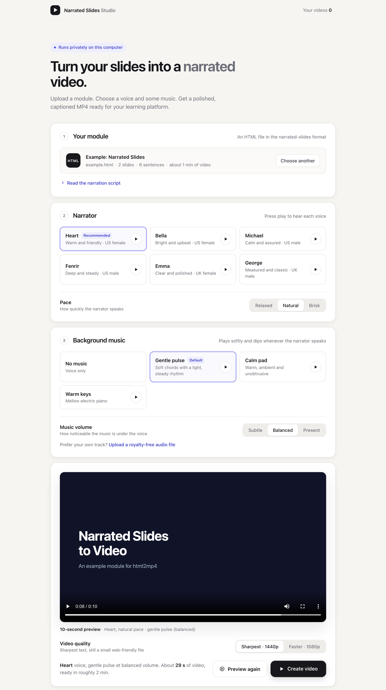

# Narrated Slides Studio

[](LICENSE)
[](pyproject.toml)
[](#requirements)

Narrated Slides Studio turns an HTML slide module into a finished training video: a natural voiceover, background
music that steps back when the narrator speaks, and captions. Everything runs on your own computer.

It was built for teams that author e-learning modules as animated HTML and need to publish them to a learning
platform as MP4. Screen-recording a browser is slow and the result drifts out of sync. This tool renders the page frame
by frame instead, so every animation lands on the sentence that triggers it and the video looks the same as the page.



## Features

- **A web app for non-technical users.** Drop in a module, pick a voice and music, listen to a 10-second preview, then create the video.
- **Neural voiceover, generated locally** with [Kokoro](https://huggingface.co/hexgrad/Kokoro-82M): six curated US and UK voices and three speaking paces.
- **Faithful to the source.** The page's own HTML, CSS and animations are used unchanged. See [Fidelity](docs/how-it-works.md#fidelity).
- **Sharp, small files.** 1440p or 1080p H.264, about 3 MB per minute, and they play in any browser or LMS.
- **Broadcast-style sound.** Loudness is normalised to −16 LUFS, and the music dips automatically under speech.
- **Captions.** A switchable caption track inside the MP4, plus `.srt` and `.vtt` files for your LMS.
- **Royalty-free music.** Three built-in music beds are synthesised in code, so there are no licences to track. You can also bring your own track.
- **Private by design.** No accounts, no uploads, no per-video cost.

## Quick start

Requires macOS on Apple silicon. Setup installs everything else, and needs no admin rights or Homebrew.

```bash
cd ~/Downloads
git clone https://github.com/akash-adhikary/narrated-slides-to-video.git
cd narrated-slides-to-video
./setup.sh
```

Then start the Studio:

```bash
./studio.sh
```

The Studio opens in your browser. You can also double-click **Open Studio.command** in Finder. Finished videos are
saved to `~/Downloads/Narrated Videos`.

New to the command line? The [Getting started guide](docs/getting-started.md) walks through every step, including the
macOS permission prompt the first time you open the Studio.

## Command line

Everything the Studio does is also available as a command:

```bash
source .venv/bin/activate

html2mp4 module.html                                   # module.mp4, module.srt, module.vtt
html2mp4 module.html --voice bf_emma --speed 1.0       # a different narrator and pace
html2mp4 module.html --music calm-pad --music-volume present
html2mp4 module.html --music none --quality 1080p
html2mp4 module.html --preview 10 -o preview.mp4       # first 10 seconds only
```

See the [CLI reference](docs/cli.md) for every option.

## Writing a module

A module is a single HTML file with three conventions: one `<section class="slide">` per scene, the narration as a
list of sentences in the page script, and a `data-c` attribute on each element that should appear with a given
sentence.

```html
<section class="slide" id="s1">
  <h2 data-c="0">Three simple rules</h2>
  <div class="card" data-c="1">Scenes</div>
  <div class="card" data-c="2" data-d="0.4">Sentences</div>
</section>

<script>
  var scenes = [
    {id:'s1', chunks:["There are three simple rules.", "First, scenes.", "Second, sentences."]}
  ];
</script>
```

[`examples/example.html`](examples/example.html) is a complete module. The [authoring guide](docs/authoring.md) covers
the format in full.

## How it works

The narration is voiced sentence by sentence and laid out on a timeline. Headless Chromium then loads the module, pauses
every CSS transition, and seeks it to the exact time of each frame. Frames are rendered in parallel at the target
resolution and encoded with x264. The voice and music are mixed, ducked and loudness-normalised, and FFmpeg combines
the picture, sound and captions into a web-optimised MP4.

The [architecture notes](docs/how-it-works.md) describe each stage and what the video does and doesn't change from the page.

## Requirements

| Platform | Status |
|---|---|
| macOS on Apple silicon (M1 or later) | Supported |
| macOS on Intel | Untested. PyTorch stopped publishing Intel Mac builds after 2.2, so setup is likely to fail. |
| Linux | Expected to work with `./setup.sh`, but untested |
| Windows | Not packaged yet |

Disk space: about 3 GB for Python, the voice model and Chromium. A 2–3 minute module takes 5–8 minutes to create at
1440p on an M-series laptop.

## Documentation

- [Getting started](docs/getting-started.md): installation and first video, for non-technical users
- [Authoring modules](docs/authoring.md): the module format and narration tips
- [CLI reference](docs/cli.md): commands, options and environment variables
- [How it works](docs/how-it-works.md): pipeline, audio, encoding, Studio, and fidelity to the source
- [Troubleshooting](docs/troubleshooting.md)
- [Build prompt](docs/build-prompt.md): the full specification as a single prompt for an AI coding assistant
- [Changelog](CHANGELOG.md)

## Contributing

Bug reports and pull requests are welcome. Read [CONTRIBUTING.md](CONTRIBUTING.md) for the development setup and how
changes are verified. To report a security issue, follow [SECURITY.md](SECURITY.md).

## License

[MIT](LICENSE) © Akash Adhikary.

Narrated Slides Studio builds on [Kokoro-82M](https://huggingface.co/hexgrad/Kokoro-82M) (Apache-2.0),
[Playwright](https://playwright.dev) (Apache-2.0), [FFmpeg](https://ffmpeg.org) and [x264](https://www.videolan.org/developers/x264.html)
(bundled through [imageio-ffmpeg](https://github.com/imageio/imageio-ffmpeg)), and [FastAPI](https://fastapi.tiangolo.com).
Each is distributed under its own licence.
